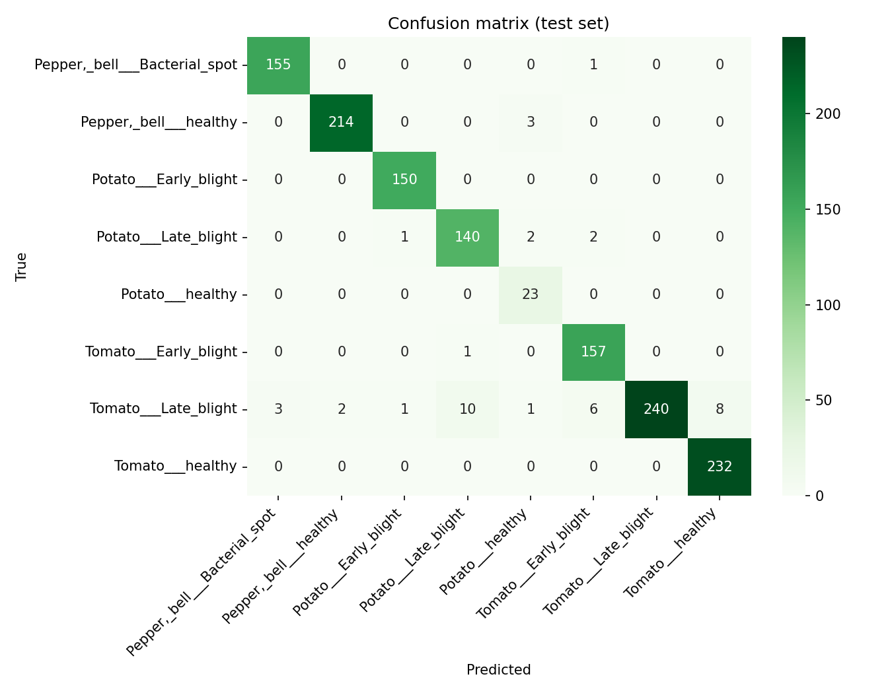

# AI-Based Plant Disease Detection and Classification System


A full-stack web application that detects and classifies plant leaf diseases from an uploaded image. A **custom Convolutional Neural Network (CNN) trained from scratch** on the PlantVillage dataset powers the predictions, served through a **FastAPI** backend and presented in a **React + Vite** frontend. Every prediction is stored in a **SQLite** database so users can review their history and see statistics on a dashboard.

---

## Table of Contents

- [Features](#features)
- [Tech Stack](#tech-stack)
- [System Architecture](#system-architecture)
- [Project Structure](#project-structure)
- [Getting Started](#getting-started)
- [Training the Model](#training-the-model)
- [Model Results](#model-results)
- [Backend API](#backend-api)
- [Frontend](#frontend)
- [Documentation](#documentation)
- [Troubleshooting](#troubleshooting)
- [Project Rules](#project-rules)
- [Future Improvements](#future-improvements)
- [License](#license)

---

## Features

- **Image-based detection**: upload a leaf photo and get the predicted disease class with a confidence score.
- **Custom CNN**: built and trained from scratch (no pretrained classifier, no external prediction API).
- **Prediction history**: every result is saved and can be browsed later.
- **Dashboard and statistics**: summary cards and charts of past predictions.
- **Disease information**: the backend exposes disease details alongside predictions.
- **Responsive UI**: a React single-page app with separate Dashboard, Detection, History, Statistics and About pages.
- **Reproducible ML pipeline**: scripts and notebooks for preprocessing, training and evaluation.
- **Measured results only**: evaluation reports (metrics, confusion matrix, training curves) are generated from real runs.

---

## Tech Stack

| Layer      | Technology                                                  |
| ---------- | ----------------------------------------------------------- |
| AI / ML    | Python, TensorFlow / Keras, NumPy, scikit-learn, Matplotlib |
| Backend    | FastAPI, Uvicorn, SQLAlchemy, SQLite                        |
| Frontend   | React, Vite, JavaScript (JSX), CSS, ESLint                  |
| Dataset    | [PlantVillage](https://www.kaggle.com/datasets/emmarex/plantdisease) |
| Tooling    | Git, Jupyter / Google Colab, npm, pip                       |

> The exact package versions are pinned in `backend/requirements.txt` and `frontend/package.json`.

---

## System Architecture

```
┌──────────────┐    image upload     ┌────────────────────┐    loads      ┌──────────────────┐
│   React UI   │ ──────────────────► │   FastAPI backend  │ ────────────► │  Trained CNN     │
│  (Vite, 5173)│ ◄────────────────── │   (Uvicorn, 8000)  │ ◄──────────── │  (.keras model)  │
└──────────────┘   JSON prediction   └─────────┬──────────┘   prediction  └──────────────────┘
                                               │
                                               ▼
                                     ┌────────────────────┐
                                     │  SQLite database   │
                                     │ (history + stats)  │
                                     └────────────────────┘
```

**Request flow**

1. The user uploads a leaf image on the **Detection** page.
2. The frontend sends it to the backend (`/api/predict`).
3. The backend validates and saves the image, preprocesses it (resize and normalize), and runs it through the CNN.
4. The predicted class and confidence are stored in SQLite and returned as JSON.
5. The frontend displays the result card; **History**, **Dashboard** and **Statistics** read the stored records.

---

## Project Structure

```
Plant-Disease-Detection/
├── ai/                          # Machine learning workspace
│   ├── dataset/                 # Dataset manifest, class names (raw images not committed)
│   │   ├── class_names.json
│   │   └── plant_manifest.csv
│   ├── models/                  # Trained model (plant_cnn_best.keras)
│   ├── notebooks/               # 03_cnn_training.ipynb (explained, step-by-step)
│   ├── reports/                 # Metrics, confusion matrix, training curves, predictions
│   └── src/
│       ├── preprocessing.py     # Image checks + 70/15/15 train/val/test split
│       ├── model_architecture.py# CNN definition
│       ├── train.py             # Training loop
│       └── evaluate.py          # Test-set evaluation and plots
│
├── backend/                     # FastAPI server
│   ├── app/
│   │   ├── main.py              # App entry point, CORS, router registration
│   │   ├── config.py            # Paths and settings
│   │   ├── database/            # SQLite connection (db.py) and ORM models (models.py)
│   │   ├── routes/              # predict, history, dashboard, diseases
│   │   ├── services/            # image, prediction and history business logic
│   │   └── utils/               # Preprocessing helpers
│   ├── uploads/                 # Uploaded images (.gitkeep keeps the folder)
│   ├── plant_disease.db         # SQLite database
│   └── requirements.txt
│
├── frontend/                    # React + Vite web app
│   ├── public/
│   └── src/
│       ├── components/          # Navbar, ImageUploader, PredictionCard, StatCard, HistoryTable
│       ├── pages/               # Dashboard, Detection, History, Statistics, About
│       ├── services/api.js      # Backend API calls
│       ├── App.jsx
│       └── main.jsx
│
├── docs/                        # Proposal, methodology, testing, user manual
├── LICENSE
└── README.md
```

---

## Getting Started

### Prerequisites

- **Python 3.10+** and `pip`
- **Node.js 18+** and `npm`
- **Git**
- (Optional) A GPU or Google Colab, only if you want to retrain the model

### 1. Clone the repository

```bash
git clone https://github.com/aliwaqar04/Plant-Disease-Detection.git
cd Plant-Disease-Detection
```

### 2. Run the backend

```bash
cd backend
python -m venv venv

# Windows (Git Bash)
source venv/Scripts/activate
# Windows (CMD / PowerShell): venv\Scripts\activate
# macOS / Linux:              source venv/bin/activate

pip install -r requirements.txt
uvicorn app.main:app --reload --port 8000
```

- API root: <http://localhost:8000>
- Interactive API docs (Swagger): <http://localhost:8000/docs>

> The trained model lives in `ai/models/`. If the model files are missing, `/api/predict` returns **503** until you train or add them. Restart the backend after adding a new model.

### 3. Run the frontend

Open a second terminal:

```bash
cd frontend
npm install
npm run dev
```

Open <http://localhost:5173> in your browser.

### 4. Try it out

1. Go to the **Detection** page.
2. Upload a clear photo of a single plant leaf.
3. View the predicted disease and confidence.
4. Check **History**, **Dashboard** and **Statistics** to see saved results.

---

## Training the Model

You can reuse the committed model or retrain it yourself.

### 1. Get the dataset

Download **PlantVillage** and extract it into `ai/dataset/raw/`. Class folders (for example `Tomato_Early_blight`) can be nested anywhere inside.

### 2. Run the pipeline

```bash
cd ai
python src/preprocessing.py     # validates images, builds the 70/15/15 split
python src/train.py             # trains the CNN, saves the model + class_names.json
python src/evaluate.py          # metrics and plots into ai/reports/
```

The notebook `ai/notebooks/03_cnn_training.ipynb` runs the same steps with explanations and plots, and works well on Google Colab.

### Data split

| Split      | Share |
| ---------- | ----- |
| Training   | 70%   |
| Validation | 15%   |
| Test       | 15%   |

---

## Model Results

All numbers are **measured on the held-out test set**, never fabricated. After running `evaluate.py`, the artifacts in `ai/reports/` are:

| File                    | Contents                                         |
| ----------------------- | ------------------------------------------------ |
| `test_report.json`      | Accuracy, precision, recall and F1 per class     |
| `confusion_matrix.png`  | Test-set confusion matrix                        |
| `Two Curve Plot.png`    | Training vs. validation accuracy / loss curves   |
| `history.json`          | Per-epoch training history                       |
| `test_predictions.csv`  | Prediction for every test image                  |

<!--
Add your own measured numbers here, for example:

| Metric              | Value |
| ------------------- | ----- |
| Test accuracy       | XX.X% |
| Macro F1-score      | X.XX  |
| Number of classes   | NN    |


-->

---

## Backend API

The backend is organized into route modules, each backed by a service layer:

| Module       | Purpose                                              |
| ------------ | ---------------------------------------------------- |
| `predict`    | Accepts an uploaded image and returns the prediction |
| `history`    | Returns past predictions stored in SQLite            |
| `dashboard`  | Aggregated figures for the dashboard / statistics    |
| `diseases`   | Disease information for the supported classes        |

Prediction endpoint:

```
POST /api/predict        # multipart/form-data with an image file
```

See the full, always up-to-date list of endpoints, request bodies and responses in the Swagger docs at <http://localhost:8000/docs> while the server is running.

---

## Frontend

| Page           | Description                                          |
| -------------- | ---------------------------------------------------- |
| **Dashboard**  | Overview cards and recent activity                   |
| **Detection**  | Upload an image and view the prediction              |
| **History**    | Table of all past predictions                        |
| **Statistics** | Charts and breakdowns of detected diseases           |
| **About**      | Information about the project                        |

Useful scripts (run inside `frontend/`):

```bash
npm run dev       # start the dev server
npm run build     # production build into dist/
npm run preview   # preview the production build
npm run lint      # lint the code
```

If the backend runs on a different host or port, update the base URL in `frontend/src/services/api.js`.

---

## Documentation

Detailed project documents are in the [`docs/`](docs) folder:

- [`project_proposal.md`](docs/project_proposal.md): goals and scope
- [`methodology.md`](docs/methodology.md): dataset, preprocessing, model and training approach
- [`testing.md`](docs/testing.md): test cases and results
- [`user_manual.md`](docs/user_manual.md): how to use the application

---

## Troubleshooting

| Problem                                   | Fix                                                                                     |
| ----------------------------------------- | --------------------------------------------------------------------------------------- |
| `/api/predict` returns **503**            | The trained model files are missing in `ai/models/`. Add or train the model, then restart the backend. |
| Frontend cannot reach the backend (CORS / network error) | Make sure the backend is running on port 8000 and the URL in `api.js` matches. |
| `uvicorn` or `pip` not found              | Activate the virtual environment first.                                                 |
| TensorFlow install fails                  | Use a supported Python version (3.10 to 3.12) and upgrade pip: `python -m pip install --upgrade pip`. |
| Poor predictions on a photo               | Use a clear, well-lit, close-up image of one leaf; the model was trained on PlantVillage-style images. |
| Port already in use                       | Change the port, e.g. `uvicorn app.main:app --reload --port 8001`.                      |

---

## Project Rules

- Train our **own CNN from scratch**; no pretrained classifier or external prediction API.
- Use **measured results**, never fabricated metrics.

---

## Future Improvements

- Support more crops and diseases, including real-field (non-lab) images
- Treatment and prevention recommendations per disease
- User authentication and per-user history
- Docker setup for one-command deployment
- Mobile-friendly camera capture and offline inference
- Model explainability (Grad-CAM heatmaps)

---

## License

This project is licensed under the **MIT License**. See the [LICENSE](LICENSE) file for details.

---

## Author

**Ali Waqar**: [@aliwaqar04](https://github.com/aliwaqar04)

If you found this project useful, consider giving it a star on GitHub.
